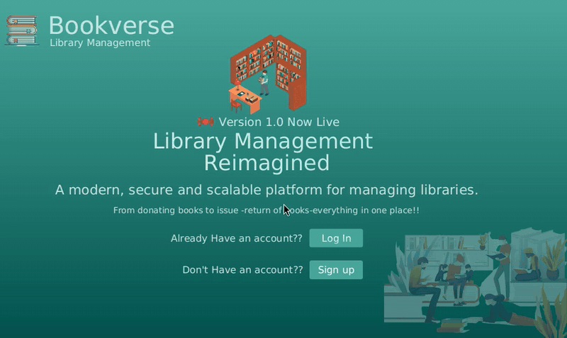
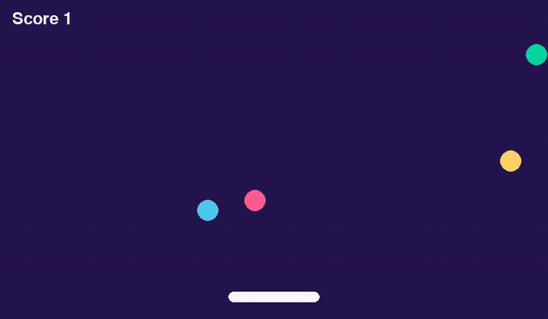
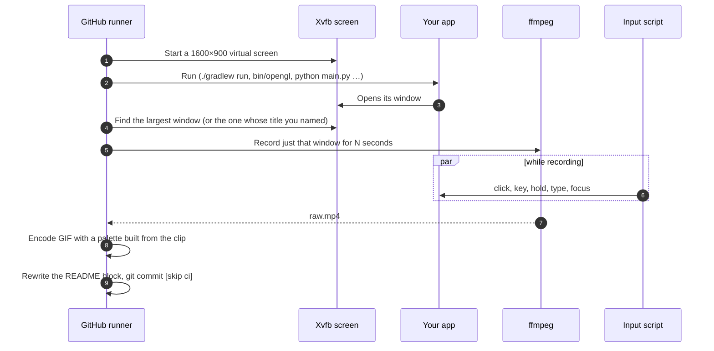

<div align="center">


# LiveNiro

**Your desktop project, running in its README.**

A GitHub Action that builds your game or desktop app, runs it on a virtual
screen, plays it with a short input script, and puts a GIF of the real thing at
the top of your README. On every push. No server, no hosting bill.

[](https://github.com/Kairo-2081/LiveNiro/actions/workflows/self-test.yml)
[](https://github.com/Kairo-2081/LiveNiro/tags)
[](./LICENSE)


[Quick start](#quick-start) ·
[Showcase](#showcase) ·
[Examples](./examples) ·
[Request a stack](https://github.com/Kairo-2081/LiveNiro/issues/new)


<sub>A C++ / OpenGL game, built and played by LiveNiro on a headless Linux runner. No Windows, no MinGW, no human.</sub>

</div>

<div align="center">

[At a glance](#at-a-glance) · [Showcase](#showcase) · [Found by LiveNiro](#found-by-liveniro) ·
[Quick start](#quick-start) · [How it works](#how-it-works) · [Stacks](#supported-stacks) ·
[Input scripts](#input-scripts) · [Options](#options) · [Recipes](#recipes) ·
[Engineering](#engineering) · [Status](#project-status-and-roadmap)

</div>

Every CS student has a project like this: a game for the first-year graphics
course, a JavaFX app for the OOP lab, a pygame weekend build. It's the most
interesting thing on their GitHub, and nobody ever sees it run. Recruiters
don't clone a repo, install a toolchain and double-click a `.bat` file, so the
project lives and dies as two screenshots.

LiveNiro makes the README show the app actually running, and re-records it
every time you push, so the demo never goes stale.

## At a glance

| | |
| --- | --- |
| **One file to add** | A short workflow file. No Dockerfile, no config file, no account anywhere. |
| **Zero-config stacks** | iGraphics (C++ / OpenGL / GLUT), JavaFX (Gradle or Maven) and pygame are detected and built automatically. |
| **Anything else** | Any app that opens a window on Linux, with your own `setup`, `build` and `run` commands: Qt, SFML, raylib, SDL, Swing, Tkinter. |
| **It plays, not just opens** | An input script clicks, types, holds keys and switches to dialogs while it records. |
| **Outputs** | A palette-optimised GIF for the README, a sharp MP4, and a poster PNG, all in `.liveniro/`. |
| **Stays current** | Runs on every push and rewrites only its own block in your README. |
| **Fast after the first run** | Gradle, Maven and pip downloads are cached; rate-limited downloads are retried. |
| **Verified** | Every change is tested in CI against three real projects, one per stack. |

## Showcase

Real projects, recorded by the same action you'd add to yours.

<table>
<tr>
<td width="50%" valign="top">

**Bounce Classic** · C++ · iGraphics / OpenGL


Menu → click **New Game** → run and jump.
[Repo](https://github.com/Kairo-2081/Bounce-Classic) · [workflow](https://github.com/Kairo-2081/Bounce-Classic/blob/main/.github/workflows/liveniro.yml)

</td>
<td width="50%" valign="top">

**BookVerse** · Java 21 · JavaFX / Gradle



Welcome screen → login dialog → dashboard.
[Repo](https://github.com/Kairo-2081/LibraryManager) · [workflow](https://github.com/Kairo-2081/LibraryManager/blob/master/.github/workflows/liveniro.yml)

</td>
</tr>
<tr>
<td width="50%" valign="top">

**Bouncer** · Python · pygame



The paddle is steered by `hold Left` / `hold Right`.
[Source](./test/fixtures/pygame-bouncer)

</td>
<td width="50%" valign="top">

**Your project here**

Add the workflow from [Quick start](#quick-start), push, and open a PR adding
your GIF to this table.

Stack LiveNiro doesn't recognise yet?
[Open an issue](https://github.com/Kairo-2081/LiveNiro/issues/new) with a link:
it becomes the next detector.

</td>
</tr>
</table>

## Found by LiveNiro

Running a project somewhere other than the machine it was written on is a
test in itself. On their first recordings, LiveNiro surfaced four real bugs in
the showcase projects, none of which ever showed up on the author's Windows
machine:

| Project | What the recording showed | Cause | Fix |
| --- | --- | --- | --- |
| Bounce Classic | Every level drawn on black | Code loads `bg.jpg`, the file is `Bg.jpg`; Windows ignores case, Linux doesn't | [#4](https://github.com/Kairo-2081/Bounce-Classic/pull/4) |
| Bounce Classic | In-game text in the wrong font | Same mismatch: `game.ttf` vs `Game.ttf` | [#4](https://github.com/Kairo-2081/Bounce-Classic/pull/4) |
| Bounce Classic | HUD read *"Health: 100Score: 5"* | `"Health: 100"` needs 12 bytes, the buffer had 11: an overflow into the score text | [#5](https://github.com/Kairo-2081/Bounce-Classic/pull/5) |
| BookVerse | *"Reimagin…"*, *"Version 1.0 Now …"* | Fixed-width labels sized for Office-only fonts; any other font overflows them | [#7](https://github.com/Kairo-2081/LibraryManager/pull/7) |

## Quick start

Add `.github/workflows/liveniro.yml` to your project:

```yaml
name: LiveNiro demo

on:
  push:
    branches: [main]
    paths-ignore: [".liveniro/**"]
  workflow_dispatch:

permissions:
  contents: write   # lets LiveNiro commit the GIF back

jobs:
  demo:
    runs-on: ubuntu-latest
    steps:
      - uses: actions/checkout@v4
      - uses: Kairo-2081/LiveNiro@v0
```

Push. A minute or two later your README has a live demo under its first
heading, and `.liveniro/` holds `demo.gif`, `demo.mp4` and `demo.png`.

To choose where the demo goes, put these two markers anywhere in your README.
LiveNiro owns what's between them and never touches the rest of the file:

```html
<!-- liveniro:start -->
<!-- liveniro:end -->
```

> [!TIP]
> Wrap your existing screenshot in the markers. It stays until the first
> recording replaces it, so the README never has an empty gap.

## How it works

```mermaid
flowchart LR
    A([git push]) --> B[Detect the stack]
    B --> C[Install toolchain<br/>restore cache]
    C --> D[Build<br/>retry on 429 / timeouts]
    D --> E[Start a virtual screen<br/>Xvfb + software OpenGL]
    E --> F[Launch the app,<br/>wait for its window]
    F --> G[Record the window<br/>while the input script plays]
    G --> H[GIF + MP4 + poster]
    H --> I[Update the README block,<br/>commit with skip ci]
```





The app is started in its own process group and the whole tree is stopped
afterwards, so Gradle daemons and child processes never outlive the run.

## Supported stacks

| Stack | Detected by | Build | Run |
| --- | --- | --- | --- |
| **iGraphics**<br/><sub>C++ / OpenGL / GLUT</sub> | `iGraphics.h` in the repo | The project's own `build.sh` if it has a Linux branch, otherwise `g++` with GLUT, SDL2_mixer and FreeType | The built binary, from the project folder so relative asset paths work |
| **JavaFX** | `openjfx` / `javafx` in `build.gradle(.kts)` or `pom.xml` | `./gradlew classes` or `mvn compile`, with the Java version read from your build file | `./gradlew run` or `mvn javafx:run` |
| **pygame** | `pygame` in `requirements.txt` / `pyproject.toml`, or an `import pygame` | A fresh virtualenv on the distro Python, falling back to `pygame-ce` when pygame has no wheel | `main.py`, `game.py`, `app.py` … or the script that calls `set_mode` |
| **custom** | `stack: custom` | Your `setup` and `build` | Your `run` |

Old iGraphics templates that include `<windows.h>` unconditionally can't build
on Linux; LiveNiro says so in one clear error instead of a page of compiler
output.

## Input scripts

A menu screen sitting still is not a demo. Give LiveNiro a script and it plays
while it records. Coordinates are pixels from the top-left of your app's window.

```yaml
      - uses: Kairo-2081/LiveNiro@v0
        with:
          duration: "14"
          actions: |
            wait 1.5
            click 1000 80            # the "New Game" button
            move 1278 718            # park the pointer in a corner
            hold Right 2.5           # run right
            key Up                   # jump
            hold Right 3
```

| Command | Does |
| --- | --- |
| `wait <sec>` | Pause |
| `click <x> <y> [button]` | Click (1 = left, 3 = right) |
| `move <x> <y>` | Move the pointer |
| `key <name>` | Press a key: `space`, `Return`, `Up`, `Left`, `Tab`, `ctrl+s`, `a` … (X11 key names) |
| `hold <key> <sec>` | Hold a key down |
| `type <text>` | Type text |
| `focus <title>` | Send the next keys to another window, such as a login dialog (the title is a regex) |

The pointer only appears in the recording when the script uses the mouse.

> [!NOTE]
> Dialogs and popups are separate windows, and nothing gives them keyboard
> focus on a bare virtual screen. Use `focus` before typing into one:
>
> ```yaml
>           actions: |
>             click 537 403            # "Log In" opens a dialog
>             wait 1.5
>             focus Bookverse Login    # the dialog's title
>             click 468 227
>             type demo@example.com
> ```

**Finding coordinates:** run the app at its normal size, take a screenshot,
and read the pixel position of the button relative to the window's top-left
corner. Any image viewer that shows the cursor position will do.

## Options

| Input | Default | What it does |
| --- | --- | --- |
| `path` | `.` | Project folder inside the repo |
| `stack` | `auto` | `auto`, `igraphics`, `javafx`, `pygame` or `custom` |
| `setup` | | Extra shell commands before the build (install packages, fetch assets) |
| `build` | detected | Override the build command |
| `run` | detected | Override the run command (required for `custom`) |
| `window` | largest window | Regex for the title of the window to record |
| `wait-timeout` | `300` | Seconds to wait for the window (first Gradle builds are slow) |
| `warmup` | `2` | Seconds between the window appearing and recording |
| `duration` | `12` | Length of the clip in seconds |
| `actions` | | [Input script](#input-scripts) |
| `screen` | `1600x900` | Virtual screen size |
| `fps` | `15` | Recording frame rate (the GIF is capped at 12) |
| `gif-width` | `800` | GIF width in pixels |
| `output-dir` | `.liveniro` | Where the files go |
| `name` | `demo` | Base file name |
| `readme` | `README.md` | README to update; `""` leaves it alone |
| `commit` | `true` | Commit the demo back (push events only) |
| `commit-message` | `docs: update LiveNiro demo [skip ci]` | Message for that commit |
| `upload-artifact` | `true` | Also attach the files to the workflow run |
| `cache` | `true` | Keep Gradle, Maven and pip downloads between runs |

**Outputs:** `stack`, `gif`, `mp4`, `poster` (paths relative to the repo root).

## Recipes

<details>
<summary><b>A game that needs a click and some play</b> (iGraphics, SDL, pygame)</summary>

See [`examples/igraphics-game.yml`](./examples/igraphics-game.yml). Keep the
clip short (10–15 s) and end on the most interesting moment: the GIF loops.

</details>

<details>
<summary><b>An app with a login dialog</b> (JavaFX, Swing, Qt)</summary>

See [`examples/javafx-app.yml`](./examples/javafx-app.yml): click the button that
opens the dialog, `focus` the dialog by title, click each field and `type`.
Use a throwaway demo account, never real credentials: the workflow file is public.

</details>

<details>
<summary><b>Any other stack</b> (Qt, SFML, raylib, Tkinter, Electron …)</summary>

```yaml
      - uses: Kairo-2081/LiveNiro@v0
        with:
          stack: custom
          setup: sudo apt-get install -y qt6-base-dev cmake
          build: cmake -B build && cmake --build build -j
          run: ./build/myapp
```

Full file: [`examples/custom-qt.yml`](./examples/custom-qt.yml).

</details>

<details>
<summary><b>A monorepo, or several demos from one repo</b></summary>

Point each step at a folder and give it its own name. Let only one of them own
the README block:

```yaml
      - uses: Kairo-2081/LiveNiro@v0
        with: { path: games/snake, name: snake }
      - uses: Kairo-2081/LiveNiro@v0
        with: { path: games/pong, name: pong, readme: "" }
```

</details>

<details>
<summary><b>Record on pull requests without committing</b></summary>

On `pull_request` events LiveNiro never commits; the GIF and MP4 are attached
to the run as an artifact instead. Add `pull_request:` to the workflow's `on:`
to preview a change's demo before merging.

</details>

## Engineering

### Decisions and trade-offs

| Decision | Why | Cost |
| --- | --- | --- |
| **Plain Bash** on Xvfb, ffmpeg and xdotool | Runs on any Ubuntu runner with no image to build, starts in seconds, and anyone can read it | Bash needs care; every script is linted with ShellCheck |
| **Windows found with `xwininfo`**, not `xdotool search` | `xdotool search` misses SDL windows when no window manager is running | One extra call per window while waiting |
| **Software OpenGL** and a **dummy audio driver** | Runners have no GPU and no sound card; apps must not crash for lack of either | Heavy 3D records at a low frame rate; no sound |
| **GIF with a per-clip palette**, plus an MP4 | GIFs play inline in every README; a palette built from the clip itself keeps them small and clean | GIFs are still larger than video, so keep clips short |
| **Commit the files** instead of only uploading an artifact | A README image needs a stable path in the repo | The repo grows by roughly 0.3–2 MB each time the demo changes |
| **Distro Python** for pygame | Runner images put a very new Python first, and pygame often has no wheel for it yet | Your project runs on the distro Python, not the newest one |
| **Retry only network-looking failures** | 429s and timeouts from package servers are transient; compile errors are not | A real outage still fails, after about 80 s of retries |

### Project layout

```text
action.yml              composite action: tools, cache, run, artifact, commit
src/
  liveniro.sh           the pipeline: detect → set up → build → run → record → encode → README
  lib/
    common.sh           logging, Action outputs, apt installs, retry_network
    detect.sh           zero-config stack detection
    display.sh          Xvfb, window discovery, window geometry
    input.sh            the input-script player
    record.sh           ffmpeg recording and GIF / MP4 / poster encoding
    readme.sh           the README marker block
  stacks/
    igraphics.sh        each stack: stack_setup, stack_build, stack_run_command
    javafx.sh
    pygame.sh
    custom.sh
test/fixtures/          small projects the self-test records
examples/               copy-paste workflows
```

### Testing

[`self-test.yml`](./.github/workflows/self-test.yml) runs on every push and pull
request. It records one real project per stack, with an input script, on a
fresh runner:

| Job | Project | Script |
| --- | --- | --- |
| pygame | [`test/fixtures/pygame-bouncer`](./test/fixtures/pygame-bouncer) | Steer the paddle left and right |
| iGraphics | [Bounce Classic](https://github.com/Kairo-2081/Bounce-Classic) | Menu → New Game → run and jump |
| JavaFX | [BookVerse](https://github.com/Kairo-2081/LibraryManager) | Welcome → login dialog → dashboard |

The log ends with the windows that were open when recording stopped, so a
scripted flow that went wrong (a dialog still open, an error alert) is visible
without downloading the GIF.

## Run it locally

LiveNiro is plain Bash, so it runs on any Ubuntu or Debian machine, or in WSL
on Windows:

```bash
sudo apt-get install xvfb ffmpeg xdotool x11-utils
git clone https://github.com/Kairo-2081/LiveNiro ~/liveniro
cd your-project
LN_DURATION=10 LN_ACTIONS=$'wait 1\nkey space' bash ~/liveniro/src/liveniro.sh
```

Every input has an `LN_` environment variable: `LN_STACK`, `LN_RUN`,
`LN_WINDOW`, `LN_README` and so on.

## Limits

- **Linux only.** The project has to build and run on Ubuntu. Windows-only code
  gets a clear error, not a silent failure.
- **Software rendering.** No GPU on runners, so heavy 3D scenes record slowly.
- **No sound** in the recording.
- **A recording, not the live app.** Visitors watch a GIF; they can't play it.
  A self-hostable "▶ Run live" launcher is on the roadmap.
- **Coordinates are pixels.** If your layout moves, update the script (or click
  a point that stays inside the button in both layouts).

## Project status and roadmap

LiveNiro is at **v0.1.2** and records the showcase projects above on every push. Pin
`@v0` to get fixes automatically, or a full tag such as `@v0.1.2` to stay on
one version.

- [x] **v0.1** · iGraphics, JavaFX, pygame and custom stacks; input scripts; README block; self-test on real projects
- [x] **v0.1.1** · `focus` for dialogs and popups; end-of-run window log
- [x] **v0.1.2** · dependency cache; retry on rate limits and timeouts
- [ ] **v0.2** · zero-config SFML, Qt, Swing, raylib, CMake and Makefile projects
- [ ] **v0.3** · "▶ Run live" badge backed by a self-hostable noVNC launcher

### Contributing a stack

A stack is one file in [`src/stacks/`](./src/stacks) with three functions,
`stack_setup`, `stack_build` and `stack_run_command`, plus a detection rule in
[`detect.sh`](./src/lib/detect.sh) and a small fixture with a self-test job.
[`pygame.sh`](./src/stacks/pygame.sh) is the shortest one to copy.

## License

[MIT](./LICENSE) © Raian Rashid Mayel
